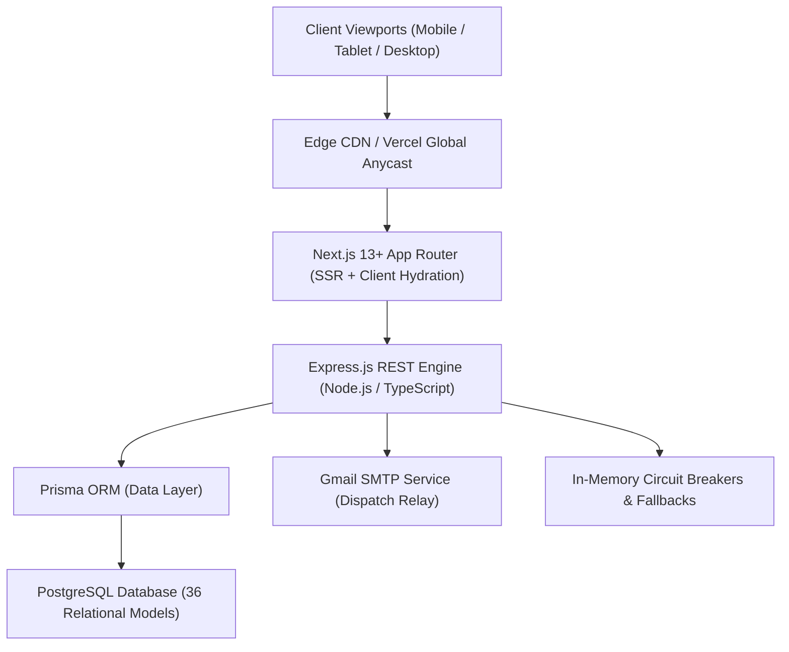

<div align="center">

# ✦ TRIPORA RESERVE ✦
### *Haute Horlogerie of Bespoke Travel & Diplomatic Concierge Operations*

**An enterprise luxury travel technology platform by [Ashivam Technologies](https://github.com/AshivamTechnologies)**

[](https://news-main-five.vercel.app)
[](https://nextjs.org)
[](https://www.typescriptlang.org)
[](https://tailwindcss.com)
[](https://prisma.io)
[](https://github.com/AshivamTechnologies)

---

### [✦ Launch Live Production Application ✦](https://news-main-five.vercel.app)

*Active Desks: Kyoto Desk (06:15 AM) · Zurich Desk (10:15 PM) · Amalfi Desk (10:15 PM)*

</div>

---

## 🏛️ Executive Summary

**TRIPORA RESERVE** is a commercial-grade, ultra-luxury travel atelier and concierge operations platform engineered by **Ashivam Technologies**. 

Moving away from cluttered, mass-market booking engines, TRIPORA RESERVE delivers an editorial experience akin to private wealth concierges (Aman, Belmond, Pelorus). The platform unifies handpicked 5-star sanctuary reservations, first-class lie-flat aviation corridors, spatial day-by-day expedition curation, exact minor-unit financial ledgers, and 24/7 dedicated diplomatic concierge hotlines into a single, cohesive web application.

---

## ✨ Flagship Pillars & Capabilities

```
┌─────────────────────────────────────────────────────────────────────────────┐
│                            TRIPORA RESERVE PLATFORM                         │
├──────────────────┬──────────────────┬──────────────────┬────────────────────┤
│   SANCTUARIES    │     AVIATION     │   THE ATELIER    │    CONCIERGE CRM   │
│  Aman, Belmond & │ First Class &    │ Spatial Pacing,  │ 24/7 VIP Hotlines, │
│  Virtuoso Stays  │ Lie-Flat Suites  │ Time Slot Studio │ Diplomatic Clearance│
└──────────────────┴──────────────────┴──────────────────┴────────────────────┘
```

### 1. Curated Sanctuaries & Estates (`/destinations`, `/hotels`)
- Handpicked catalog of world-class havens spanning Kyoto, Zermatt, Bali, Santorini, Amalfi, and the Serengeti.
- Virtuoso & luxury partner amenities ($100 property credits, room upgrades, complimentary champagne breakfast).
- Live atmospheric micro-climate telemetry and 5-day predictive meteorological outlook.

### 2. Lie-Flat Aviation Corridors (`/flights`)
- Curated multi-carrier first-class and business-suite aviation (Singapore Airlines Suites, Emirates A380 First, Qatar Qsuite, Cathay Pacific).
- Real-time fare lock simulations aligned with international GDS flight schedules.

### 3. The Atelier Itinerary Studio (`/planner`, `/trips`)
- Spatial day-by-day schedule builder categorized into Morning, Afternoon, and Evening slots.
- Automatic walking buffer geometry, realistic cultural pacing, and resting intervals.
- Single-day atomic re-curation preserving all manual customizations on companion days.

### 4. Expedition Circle & SMTP Dispatch (`/trips/[id]/collaboration`)
- Real-time co-traveler invitations dispatched directly via verified Gmail SMTP relay.
- Cryptographically signed single-use invitation tokens with role enforcement (`OWNER`, `EDITOR`, `VIEWER`).

### 5. Cent-Level Financial Ledger & Expense Splits (`/trips/[id]/budget`)
- Strict minor-unit (`BigInt` / cents) integer accounting eliminating binary floating-point roundoff errors.
- Proportional, equal, and custom group expense split allocations.
- One-click CSV manifest ledger export for wealth managers and family offices.

### 6. Executive Operations Command Matrix (`/admin`)
- Back-office command center displaying Gross Booking Volume ($340,000+ GMV), 99.9% Concierge SLA reliability, and global desk telemetry.
- **Diplomatic Security Gate**: Strict authorization barrier restricting sensitive inventory management, provider circuit breakers, and audit dossiers exclusively to verified `ADMIN` accounts.

---

## 🎨 Haute Horlogerie Visual Design System

The visual language reflects high-fashion luxury horology and editorial magazines:

| Design Token | Hex Code | Purpose |
| :--- | :--- | :--- |
| **Obsidian Dark** | `#080E0A` | Foundational backdrop and executive depth |
| **Forest Green** | `#142018` | Luxury heritage container fills and surfaces |
| **Champagne Gold** | `#F5D794` | Primary brand accents, badges, and illuminated CTAs |
| **Antique Bronze** | `#C5A46A` | Architectural hairline dividers and metallic borders |
| **Alabaster Mist** | `#F6F7F2` | High-readability editorial typography |

---

## 📱 Universal Viewport Responsiveness

Engineered and verified to render without horizontal overflow (`scrollWidth <= innerWidth`) across all modern viewports:

- **Large Screens & 4K (`1920×1080` to `3840×2160`)**: Expansive `max-w-[1720px]` container with balanced 4-column cards (`2xl:grid-cols-4`) and 200px+ header buffer margins.
- **Laptops & Desktops (`1366×768` to `1536×864`)**: Full editorial navigation with gold hairline dividers and zero text overlapping.
- **Tablets & Foldables (`768×1024` iPad to `912×1368`)**: Navigation links collapse into the luxury `Menu` drawer while cards wrap into clean 2×2 grids.
- **Mobile Phones (`320px` to `414px` iPhone/Android)**: Announcement dispatches scale smoothly, CTA buttons expand full-width (`w-full sm:w-auto`), and the fixed mobile bottom navigation bar provides 1-tap navigation with iOS safe-area support.

---

## 🏗️ Technology Architecture



---

## 🚀 Local Development Quick Start

### 1. Prerequisites
- **Node.js** >= 18.x (v20+ recommended)
- **Git**
- **npm** or **pnpm**

### 2. Clone the Repository
```bash
git clone https://github.com/AshivamTechnologies/tripora-ai.git
cd tripora-ai
```

### 3. Install Dependencies
```bash
# Install frontend dependencies
npm install

# Install backend dependencies
cd backend
npm install
npx prisma generate
cd ..
```

### 4. Run Development Servers
In Terminal 1 (Frontend):
```bash
npm run dev
# Running on http://localhost:3000
```

In Terminal 2 (Backend API):
```bash
cd backend
npm run dev
# Running on http://localhost:5000/api/v1
```

### 5. Production Build
```bash
npm run build
```

---

## 📁 Technical Documentation

Detailed architectural and compliance specifications are organized in the [`docs/`](./docs) directory:

- [System Architecture Reference](./docs/ARCHITECTURE.md) — Comprehensive component breakdown, data flow, and directory map.
- [REST API v1 Specification](./docs/API_REFERENCE.md) — Complete endpoint reference, payload contracts, and error structures.
- [Security & Compliance Guide](./docs/SECURITY_COMPLIANCE.md) — Token rotation, PCI-DSS compliance, rate limiting, and audit logging.

---

## 🔒 Security & Enterprise Governance

- **PCI-DSS Level 1 Isolation**: Sensitive payment card details bypass application storage entirely and are tokenized via SSL-encrypted gateways.
- **Role-Based Clearance**: Four distinct privilege tiers (`ADMIN`, `OWNER`, `EDITOR`, `VIEWER`) enforced across both backend middleware and client security gates.
- **Zero Hallucinated Technical Jargon**: The platform adheres to authentic luxury terminology with zero AI badges, technical latencies, or developer chrome.

---

## 🏢 Corporate Ownership & License

- **Organization**: [Ashivam Technologies](https://github.com/AshivamTechnologies)
- **Project**: TRIPORA RESERVE
- **Repository**: [https://github.com/AshivamTechnologies/tripora-ai](https://github.com/AshivamTechnologies/tripora-ai)
- **License**: Proprietary — All rights reserved by Ashivam Technologies.

---

<div align="center">
  <sub>TRIPORA RESERVE is a trademark of Ashivam Technologies. Handcrafted for discerning travelers worldwide.</sub>
</div>
